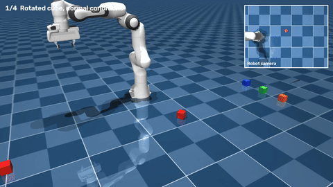
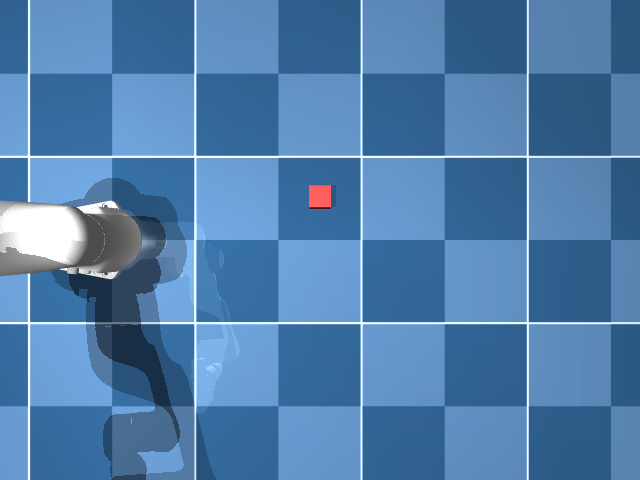

# Vision-Guided Pick-and-Place with a Franka Panda (MuJoCo)

A full **perception → planning → control** pipeline for a 7-DoF robot arm in simulation:
a top-down camera detects a cube, the pixel is converted to a table position, 6-DoF inverse
kinematics plans the grasp, and a gravity-compensated position controller picks it up.
Prototyped in Python; the IK solver is also implemented in **C++ (Eigen + MuJoCo C API)** and called from the Python pipeline through **pybind11**.
<p align="center">
  
</p>
<p align="center">
<p align="center">
  
</p>
<p align="center">

## Results

| Metric | Result |
|---|---|
| Pick success, 50 random cube positions (no rotation) | **50/50 (100%)** |
| Pick success, random position + rotation (±45°) | 98% → **100%** with gripper alignment |
| Worst-case slip in the gripper (rotated cubes) | **33 mm → 3 mm** with gripper alignment |
| Cube rotation detection error | mean 0.38°, max 2.57° |
| Cube detection error | mean **1.56 mm**, max 2.61 mm (1 pixel ≈ 2.3 mm) |
| IK accuracy | 0.031 mm position, 0.000043 rad orientation |
| IK solve time, same process (avg of 1000) | **C++ 35 µs** vs Python 500 µs (**14×**); pybind11 call overhead ≈ 1.6 µs |
| C++ IK inside the pipeline (pybind11) | identical results on all 50 evaluation trials |
| Steady-state hand error | 5.6 mm → under 0.05 mm with gravity compensation |

Test area: x = 0.35 to 0.65 m, y = −0.25 to 0.25 m, fixed random seed (`eval_pick.py`).

## Pipeline

1. **Observation pose:** rotate the base out of the camera's view.
2. **Perception:** render the top camera, threshold red pixels, take the centroid, convert pixel → table (x, y), and measure the cube's rotation (`minAreaRect`).
3. **Planning:** 6-DoF IK for a pre-grasp point (30 cm above) and a grasp point.
4. **Control:** smooth joint-space interpolation, position actuators + gravity compensation.
5. **Grasp:** descend → close gripper → lift.

## Robustness Tests

The first detector worked perfectly under ideal conditions, so I added realistic problems on purpose
to find where it breaks, then fixed each one and measured again. Each test is 50 trials with random cube
position and rotation, same seeds for every run. **Original** = fixed RGB color thresholds, average of all
red pixels, no grasp check. **Current** = HSV red test, blur, largest red region, top-face filter, and
depth-based grasp selection. Reproduce with `python run_all_tests.py` (writes `results.md`).

Results from commit `f521303`: 50 trials each, random position and rotation, fixed seeds.
Detection error is mean / max. Original = RGB thresholds, no blur, whole-image average, no grasp check.

| Test | Original: success | Original: detection error | Current: success | Current: detection error |
|---|---|---|---|---|
| Normal conditions | 100% | 1.61 / 2.28 mm | 100% | 1.63 / 2.30 mm |
| Camera noise, sigma = 40 | 2% | 58.43 / 85.77 mm | 100% | 1.66 / 2.29 mm |
| Camera noise, sigma = 60 | 0% | 150.56 / 241.43 mm | 100% | 1.70 / 2.53 mm |
| Dim light (x0.2) | 0% | cube not found | 100% | 1.71 / 2.17 mm |
| Bright light (x2.5) | 56% | 18.28 / 29.14 mm | 100% | 3.33 / 18.94 mm |
| Blue / green / orange distractors | 100% | 1.62 / 2.28 mm | 100% | 1.63 / 2.26 mm |
| Second red cube, >= 10 cm away | 0% | 116.34 / 226.18 mm | 100% | 1.62 / 2.02 mm |
| Second red cube, 10 mm gap | 0% | 28.93 / 29.96 mm | 100% | 1.62 / 2.30 mm |
| Second red cube, 2 mm gap | 0% | 24.91 / 26.00 mm | 96% | 2.55 / 24.79 mm |

Under ideal conditions the two are equally accurate (1.61 vs 1.63 mm). The gain is robustness: the current
method keeps working in every case where the original fails.

## The Math

### 1. Forward kinematics check

Rotating only the base joint should move the hand on a horizontal circle (constant height and radius).

$$r = \sqrt{x^2 + y^2}$$

| joint1 (rad) | hand (x, y, z) m | r (m) | θ = arctan(y/x) (rad) |
|---|---|---|---|
| 0.0 | (0.554, 0.000, 0.625) | 0.554 | 0.000 |
| 0.5 | (0.487, 0.266, 0.625) | 0.555 | 0.500 |
| 1.0 | (0.300, 0.467, 0.625) | 0.555 | 1.000 |

z stays at 0.625 m, r stays at 0.555 m, and θ matches the joint angle (x > 0, y ≥ 0, first quadrant).

### 2. Inverse kinematics (damped least squares)

The Jacobian $J$ (6 × 7) maps joint velocities to hand velocity. Each iteration:

$$e = \begin{bmatrix} p_{target} - p_{hand} \\ \omega_{err} \end{bmatrix}, \qquad
\Delta q = J^T \left(J J^T + \lambda^2 I\right)^{-1} e, \qquad \lambda = 0.01$$

Orientation error comes from the quaternion difference, converted to a rotation vector:

$$q_{err} = q_{target} \otimes q_{hand}^{-1}  \quad \rightarrow \quad  \omega_{err}$$

Joint angles are clamped to their limits after each step. The damping term $\lambda$ keeps the
solve stable near singular poses. The arm is **redundant** (7 joints, 6 constraints), so many
solutions exist; the solver returns the one closest to its starting pose. Converges in 3 to 4 iterations.

### 3. Gravity compensation

Each actuator is a position (P) controller: $\tau = k_p (q_{target} - q) - k_d \dot{q}$.
Gravity pulls the arm down, so the joint must sit slightly off target before the controller pushes back.
This is **steady-state error**: the hand settled 5.4 mm below its target in z (5.6 mm total).

Fix: add the gravity (bias) torque directly:

$$\tau = \tau_{ctrl} + g(q)$$

In code: `data.qfrc_applied[:7] = data.qfrc_bias[:7]`. Error dropped to under 0.05 mm.

### 4. Pinhole camera: pixel ↔ table position

Camera 1.0 m above the table, looking straight down, 640 × 480 image, vertical field of view 60°.

Focal length in pixels:

$$f = \frac{H/2}{\tan(\text{fovy}/2)} = \frac{240}{\tan 30^\circ} = 415.7 \text{ px}$$

Depth to the cube's top face: $Z = 1.0 - 0.05 = 0.95$ m.

Pixel → table (inverse projection):

$$x = x_{cam} + (u - c_x)\frac{Z}{f}, \qquad y = y_{cam} - (v - c_y)\frac{Z}{f}$$

Resolution on the table: $Z/f = 0.95 / 415.7 = 2.3$ mm per pixel.

Check for a cube at (0.5, 0.1): predicted pixel (320, 196.2), detected (319.6, 195.6), error 1.7 mm.

### 5. Grasp height

IK controls the hand base, but the fingertips are 0.1034 m below it:

$$z_{hand} = z_{cube} + d_{tip} = 0.025 + 0.1034 = 0.128 \text{ m}$$

Expected cube height after lifting the hand to 0.30 m: $0.30 - 0.103 = 0.197$ m. Measured: 0.192 m.
The 5 mm gap is the cube's weight (not included in gravity compensation) plus slight finger slip.

### 6. Smooth motion

Joint targets are blended with a smoothstep so the arm starts and stops with zero velocity
(no jerk that could knock the cube):

$$s(\tau) = 3\tau^2 - 2\tau^3, \qquad q(\tau) = q_{start} + s(\tau) (q_{goal} - q_{start}), \quad \tau \in [0, 1]$$

### 7. Cube rotation and gripper alignment

Width of a rotated cube measured across the fingers:

$$w(\theta) = a\left(|\cos\theta| + |\sin\theta|\right)$$

Worst case, $\theta = 45^\circ$: $w = 0.05 \times (0.707 + 0.707) = 0.0707$ m, which is less than the
0.08 m open gripper. So the cube always fits, but the fingers close on its corners.

A square looks the same every 90°, so the detected angle is folded into $[-45^\circ, 45^\circ)$.
Image rows point down while world y points up, so $\theta_{world} = -\theta_{image}$.

The grasp orientation is "pointing down" turned by $\theta$ about the world vertical axis:

$$q_{grasp} = q_z(\theta) \otimes q_{down}, \qquad q_z(\theta) = \left(\cos\tfrac{\theta}{2},\ 0,\ 0,\ \sin\tfrac{\theta}{2}\right)$$

Grip quality is measured as slip: $s = z_{ideal} - z_{final}$, with $z_{ideal} = 0.197$ m.

## Challenges and How I Solved Them

**1. Cube invisible to the camera.** Two possible causes: the arm blocking the view, or the
robot's home keyframe moving the cube. `debug_cube.py` showed the cube was in the right place, so it
was occlusion. Geometry confirmed it: the line of sight crosses the hand's height 6.6 cm from the
hand's center, inside the ~0.2 m wide hand. Fix: an **observation pose** (swing the arm away, take the
picture, then grasp), the same approach real robots use.

**2. Color filter found zero pixels.** The threshold assumed dark red (G, B < 80), but the light washed
the cube to RGB (255, 95, 95). I measured actual pixel values (`check_color.py`) instead of guessing, then
switched to a **relative** test (R much larger than G and B), which holds up when lighting changes.

**3. Gravity sag.** See Math §3. A pure P controller can't reach the target under gravity; fixed
with gravity compensation.

**4. A wrong success check.** The first pick was marked FAILED because I guessed a 0.2 m threshold.
Computing the expected height (0.197 m) showed the pick had worked. Lesson: derive pass criteria, don't guess them.

**5. Fair benchmarking.** A single run isn't reliable, so every timing is an average of 1000 solves, both
versions do identical work (fresh simulation state each solve), and comparisons run back-to-back in the same
session. A refactor once made the C++ solver 70% slower (34 → 58 µs): each solve started with the fingers
closed, which created finger contacts that `mj_forward` had to resolve. Starting from the home pose
(fingers open) fixed it.

**6. ARM laptop.** Developed on a Snapdragon (ARM64) laptop in WSL2 Ubuntu 24.04. Chose MuJoCo
(CPU physics, ARM support) over Gazebo/Isaac Sim, and tested the 3D viewer before building on it.

**7. Rotated cubes looked fine but weren't.** With random rotation and no gripper alignment, 49/50 picks
still succeeded, so the success rate hid the problem. Tracking the final height showed the cube slipping
up to 33 mm in the fingers (grabbed by its corners), and one fell out. After detecting the rotation and
turning the gripper to match, slip dropped to 3 mm on every trial. Lesson: success rate alone can hide
a bad grasp; measure grasp quality too.

**8. A "71 µs pybind11 overhead" that wasn't.** Called from Python, the C++ IK took 105 µs vs 34 µs
standalone. I ruled out causes one at a time by testing: a slower copy of the MuJoCo library, memory
allocation, and plugin registration. The real cause: importing Python's `mujoco` sets the global timer
callback `mjcb_time`, so every `mj_forward` records internal timings. That costs 5.5 → 19.5 µs per call
(3.5×), × 5 calls per solve ≈ 70 µs. Proven by clearing it (back to 5.5 µs) and restoring it (slow again).
With the timer off for both, the fair speedup is 14× and the real pybind11 call overhead is about 1.6 µs.
This also corrected an earlier claim here (16×), which had compared Python with the timer on against C++
with it off.

**9. A refactor that made the C++ IK 70% slower.** Splitting the solver into a reusable class took it from
34 µs to 58 µs per solve. Running the old and new versions back-to-back ruled out laptop noise. The cause: the
new code set only the 7 arm joints, so the fingers started fully closed. Closed fingers touch, and `mj_forward`
resolves those contacts on every IK iteration. Starting from the home pose (fingers open) brought it back to 34 µs.
Lesson: a change that is irrelevant to the math (fingers don't move the hand) can still matter to the simulator.

**10. Camera noise broke the cube center.** The center was the average of every red pixel in the image, so
noise that turned a few floor pixels red pulled it off target: σ = 40 gave 2% success and 58 mm error. I tested
two fixes separately (an ablation). Using only the largest red region fixed success but its error grew to 8.25 mm
max at σ = 60, because noise still frays the cube's outline. A 5 × 5 blur before the color test kept the error flat
(about 1.7 mm) because it removes noise before the test. I kept both, since the largest region matters later.

**11. Lighting showed my color test was really a brightness test.** At 0.2× light the cube rendered as
RGB (136, 55, 55) and failed `r > 150`; at 2.5× the top face washed to (255, 172, 172) and failed `r − g > 100`
while the darker sides still passed, putting the center 18 mm off. Switching to HSV (hue = which color,
saturation = how strong) fixed dim light, but **doubled** the error at normal light. Pixel counts showed why:
off-center cubes gained about 100 red pixels, matching the predicted visible side faces
(21.9 px × 5.9 px ≈ 129 px). Side faces sit lower than the top but get projected as if at top height, pulling
the center inward. Keeping only the brightest part of the red region (V ≥ 0.85 × its 95th percentile, i.e. the
top face, lit from above) restored accuracy. Along the way, a patch silently failed and a flag was ignored,
so "HSV + top face" first gave numbers identical to plain HSV. Lesson: when a fix changes nothing at all,
check that it ran.

**12. Distractors were easier than intended.** I chose a red-orange meant to sit near the red hue limit, but
the lighting rendered it as RGB (255, 233, 49), hue 27 vs a red window of ≤ 10, so zero of its pixels passed.
The honest claim is "blue, green and orange cubes are rejected," not "robust to look-alike colors."

**13. Two identical red cubes.** No color rule can separate them. Averaging all red pixels aimed between the
cubes (116 mm off); the largest region picks one. With cubes almost touching, detection held down to a 5 mm
gap, but success fell to 76% at a 10 mm gap. Logging which side the neighbor was on showed all failures
(12 of 23) had it along the finger direction and none (0 of 27) had it sideways: a finger landed on the
neighbor. Fix: a square cube can be grasped two ways (90° apart), so a depth image checks both finger landing
zones and picks the clear one. Success at a 10 mm gap went from 76% to 100%. At a 2 mm gap it is 96%; the
remaining failures are likely the two cubes merging into one region in the image.

## Limitations
- Bright light (2.5×): a few trials are still about 19 mm off; I haven't found the cause.
- Blur slightly worsens the rotation estimate (max 4.2° vs 2.6°), with no effect on grasp quality.
- Changing what is in the scene shifts results by about 0.04 mm (likely rendering); all reported
  robustness numbers come from one run of `run_all_tests.py` on one commit.

- Cube is red, of known size and height; camera is straight overhead.
- One object at a time, no clutter.
- Simulation only; gravity compensation uses a perfect mass model.
- `mjcb_time` is left on in the pipeline; clearing it is process-wide and disables MuJoCo's internal profiling timers.

## Project Structure

| File | Purpose |
|---|---|
| `scene.py` | Builds the scene: Panda + cube + top camera |
| `pick_cube.py` | Full pipeline with the 3D viewer |
| `run_all_tests.py`, `results.md` | Runs every robustness test (original vs current) and writes the table |
| `light_probe.py`, `orange_probe.py` | Pixel-color probes from Challenges 11 and 12 |
| `eval_pick.py` | 50-trial evaluation (`--rotate`: random cube rotation, `--align`: rotate gripper to match, `--cpp`: C++ IK) |
| `detect_cube.py` | Detection + pixel-to-world check |
| `fk_test.py`, `ik_test.py`, `ik_move.py` | FK, position IK, 6-DoF IK + gravity compensation |
| `cpp/` | C++ IK solver (`ik.h`, `ik.cpp`), standalone benchmark (`main.cpp`), pybind11 module (`bindings.cpp`) |
| `test_binding.py`, `bench_binding.py` | C++ vs Python IK: same-answer check and same-process benchmark |
| `ik_benchmark.py` | Original Python IK benchmark |
| `inspect_arm.py`, `move_arm.py`, `test_viewer.py` | Setup and first control tests |
| `check_color.py`, `debug_cube.py` | Debugging tools from Challenges 1 and 2 |

## Setup

Tested on Ubuntu 24.04 (WSL2, ARM64), Python 3.12, MuJoCo 3.16.0.

```bash
python3 -m venv .venv && source .venv/bin/activate
pip install -r requirements.txt
git clone --depth 1 https://github.com/google-deepmind/mujoco_menagerie.git
python pick_cube.py      # watch one pick
python eval_pick.py      # 50-trial evaluation
```

C++ IK and Python module (needs the MuJoCo C library in `~/libs/mujoco-3.16.0`, `libeigen3-dev`, `python3-dev`):

````bash
cmake -S cpp -B cpp/build -Dpybind11_DIR=$(python -m pybind11 --cmakedir) \
      -DPython_EXECUTABLE=$(which python) -DPYBIND11_FINDPYTHON=ON
cmake --build cpp/build                       # builds cpp/build/ik and panda_ik*.so (project root)
./cpp/build/ik                                # standalone C++ benchmark
python eval_pick.py --rotate --align --cpp    # pipeline using the C++ IK
```

## Next Steps

- Use `mj_kinematics` + `mj_comPos` instead of `mj_forward` inside IK (IK needs no collisions or dynamics).
- Add sensor noise and clutter; try a depth camera.

---
Robot model: Franka Emika Panda from [MuJoCo Menagerie](https://github.com/google-deepmind/mujoco_menagerie).
