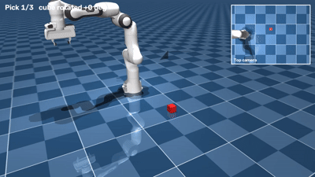
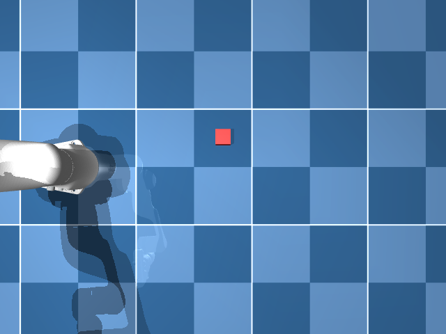

# Vision-Guided Pick-and-Place with a Franka Panda (MuJoCo)

A full **perception → planning → control** pipeline for a 7-DoF robot arm in simulation:
a top-down camera detects a cube, the pixel is converted to a table position, 6-DoF inverse
kinematics plans the grasp, and a gravity-compensated position controller picks it up.
Prototyped in Python; the IK solver is also implemented in **C++ (Eigen + MuJoCo C API)**.
<p align="center">
  
</p>
<p align="center">
<p align="center">
  
</p>
<p align="center">

## Results

| Metric | Result |
|---|---|
| Pick success, 50 random cube positions (no rotation) | **50/50 (100%)** |
| Pick success, random position + rotation (±45°) | 98% → **100%** with gripper alignment |
| Worst-case slip in the gripper (rotated cubes) | **33 mm → 3 mm** with gripper alignment |
| Cube rotation detection error | mean 0.38°, max 2.57° |
| Cube detection error | mean **1.56 mm**, max 2.61 mm (1 pixel ≈ 2.3 mm) |
| IK accuracy | 0.031 mm position, 0.000043 rad orientation |
| IK solve time (average of 1000) | **C++ 38.3 µs** vs Python 611 µs (16×) |
| Steady-state hand error | 5.6 mm → under 0.05 mm with gravity compensation |

Test area: x = 0.35 to 0.65 m, y = −0.25 to 0.25 m, fixed random seed (`eval_pick.py`).

## Pipeline

1. **Observation pose:** rotate the base out of the camera's view.
2. **Perception:** render the top camera, threshold red pixels, take the centroid, convert pixel → table (x, y), and measure the cube's rotation (`minAreaRect`).
3. **Planning:** 6-DoF IK for a pre-grasp point (30 cm above) and a grasp point.
4. **Control:** smooth joint-space interpolation, position actuators + gravity compensation.
5. **Grasp:** descend → close gripper → lift.

## The Math

### 1. Forward kinematics check

Rotating only the base joint should move the hand on a horizontal circle (constant height and radius).

$$r = \sqrt{x^2 + y^2}$$

| joint1 (rad) | hand (x, y, z) m | r (m) | θ = arctan(y/x) (rad) |
|---|---|---|---|
| 0.0 | (0.554, 0.000, 0.625) | 0.554 | 0.000 |
| 0.5 | (0.487, 0.266, 0.625) | 0.555 | 0.500 |
| 1.0 | (0.300, 0.467, 0.625) | 0.555 | 1.000 |

z stays at 0.625 m, r stays at 0.555 m, and θ matches the joint angle (x > 0, y ≥ 0, first quadrant).

### 2. Inverse kinematics (damped least squares)

The Jacobian $J$ (6 × 7) maps joint velocities to hand velocity. Each iteration:

$$e = \begin{bmatrix} p_{target} - p_{hand} \\ \omega_{err} \end{bmatrix}, \qquad
\Delta q = J^T \left(J J^T + \lambda^2 I\right)^{-1} e, \qquad \lambda = 0.01$$

Orientation error comes from the quaternion difference, converted to a rotation vector:

$$q_{err} = q_{target} \otimes q_{hand}^{-1}  \quad \rightarrow \quad  \omega_{err}$$

Joint angles are clamped to their limits after each step. The damping term $\lambda$ keeps the
solve stable near singular poses. The arm is **redundant** (7 joints, 6 constraints), so many
solutions exist; the solver returns the one closest to its starting pose. Converges in 3 to 4 iterations.

### 3. Gravity compensation

Each actuator is a position (P) controller: $\tau = k_p (q_{target} - q) - k_d \dot{q}$.
Gravity pulls the arm down, so the joint must sit slightly off target before the controller pushes back.
This is **steady-state error**: the hand settled 5.4 mm below its target in z (5.6 mm total).

Fix: add the gravity (bias) torque directly:

$$\tau = \tau_{ctrl} + g(q)$$

In code: `data.qfrc_applied[:7] = data.qfrc_bias[:7]`. Error dropped to under 0.05 mm.

### 4. Pinhole camera: pixel ↔ table position

Camera 1.0 m above the table, looking straight down, 640 × 480 image, vertical field of view 60°.

Focal length in pixels:

$$f = \frac{H/2}{\tan(\text{fovy}/2)} = \frac{240}{\tan 30^\circ} = 415.7 \text{ px}$$

Depth to the cube's top face: $Z = 1.0 - 0.05 = 0.95$ m.

Pixel → table (inverse projection):

$$x = x_{cam} + (u - c_x)\frac{Z}{f}, \qquad y = y_{cam} - (v - c_y)\frac{Z}{f}$$

Resolution on the table: $Z/f = 0.95 / 415.7 = 2.3$ mm per pixel.

Check for a cube at (0.5, 0.1): predicted pixel (320, 196.2), detected (319.6, 195.6), error 1.7 mm.

### 5. Grasp height

IK controls the hand base, but the fingertips are 0.1034 m below it:

$$z_{hand} = z_{cube} + d_{tip} = 0.025 + 0.1034 = 0.128 \text{ m}$$

Expected cube height after lifting the hand to 0.30 m: $0.30 - 0.103 = 0.197$ m. Measured: 0.192 m.
The 5 mm gap is the cube's weight (not included in gravity compensation) plus slight finger slip.

### 6. Smooth motion

Joint targets are blended with a smoothstep so the arm starts and stops with zero velocity
(no jerk that could knock the cube):

$$s(\tau) = 3\tau^2 - 2\tau^3, \qquad q(\tau) = q_{start} + s(\tau) (q_{goal} - q_{start}), \quad \tau \in [0, 1]$$

### 7. Cube rotation and gripper alignment

Width of a rotated cube measured across the fingers:

$$w(\theta) = a\left(|\cos\theta| + |\sin\theta|\right)$$

Worst case, $\theta = 45^\circ$: $w = 0.05 \times (0.707 + 0.707) = 0.0707$ m, which is less than the
0.08 m open gripper. So the cube always fits, but the fingers close on its corners.

A square looks the same every 90°, so the detected angle is folded into $[-45^\circ, 45^\circ)$.
Image rows point down while world y points up, so $\theta_{world} = -\theta_{image}$.

The grasp orientation is "pointing down" turned by $\theta$ about the world vertical axis:

$$q_{grasp} = q_z(\theta) \otimes q_{down}, \qquad q_z(\theta) = \left(\cos\tfrac{\theta}{2},\ 0,\ 0,\ \sin\tfrac{\theta}{2}\right)$$

Grip quality is measured as slip: $s = z_{ideal} - z_{final}$, with $z_{ideal} = 0.197$ m.

## Challenges and How I Solved Them

**1. Cube invisible to the camera.** Two possible causes: the arm blocking the view, or the
robot's home keyframe moving the cube. `debug_cube.py` showed the cube was in the right place, so it
was occlusion. Geometry confirmed it: the line of sight crosses the hand's height 6.6 cm from the
hand's center, inside the ~0.2 m wide hand. Fix: an **observation pose** (swing the arm away, take the
picture, then grasp), the same approach real robots use.

**2. Color filter found zero pixels.** The threshold assumed dark red (G, B < 80), but the light washed
the cube to RGB (255, 95, 95). I measured actual pixel values (`check_color.py`) instead of guessing, then
switched to a **relative** test (R much larger than G and B), which holds up when lighting changes.

**3. Gravity sag.** See Math §3. A pure P controller can't reach the target under gravity; fixed
with gravity compensation.

**4. A wrong success check.** The first pick was marked FAILED because I guessed a 0.2 m threshold.
Computing the expected height (0.197 m) showed the pick had worked. Lesson: derive pass criteria, don't guess them.

**5. Fair benchmarking.** A single C++ run (42.9 µs) isn't reliable. Both versions were averaged over
1000 solves and do identical work, including creating a fresh simulation state each solve. The 16× comes
from removing Python's per-call overhead; both call the same MuJoCo C library.

**6. ARM laptop.** Developed on a Snapdragon (ARM64) laptop in WSL2 Ubuntu 24.04. Chose MuJoCo
(CPU physics, ARM support) over Gazebo/Isaac Sim, and tested the 3D viewer before building on it.

**7. Rotated cubes looked fine but weren't.** With random rotation and no gripper alignment, 49/50 picks
still succeeded, so the success rate hid the problem. Tracking the final height showed the cube slipping
up to 33 mm in the fingers (grabbed by its corners), and one fell out. After detecting the rotation and
turning the gripper to match, slip dropped to 3 mm on every trial. Lesson: success rate alone can hide
a bad grasp; measure grasp quality too.

## Limitations

- Cube is red, of known size and height; camera is straight overhead.
- One object at a time, no clutter.
- Simulation only; gravity compensation uses a perfect mass model.
- The C++ IK is standalone and not yet called from the Python pipeline.

## Project Structure

| File | Purpose |
|---|---|
| `scene.py` | Builds the scene: Panda + cube + top camera |
| `pick_cube.py` | Full pipeline with the 3D viewer |
| `eval_pick.py` | 50-trial evaluation (`--rotate`: random cube rotation, `--align`: rotate gripper to match) |
| `detect_cube.py` | Detection + pixel-to-world check |
| `fk_test.py`, `ik_test.py`, `ik_move.py` | FK, position IK, 6-DoF IK + gravity compensation |
| `ik_benchmark.py`, `cpp/` | Python vs C++ IK benchmark |
| `inspect_arm.py`, `move_arm.py`, `test_viewer.py` | Setup and first control tests |
| `check_color.py`, `debug_cube.py` | Debugging tools from Challenges 1 and 2 |

## Setup

Tested on Ubuntu 24.04 (WSL2, ARM64), Python 3.12, MuJoCo 3.16.0.

```bash
python3 -m venv .venv && source .venv/bin/activate
pip install -r requirements.txt
git clone --depth 1 https://github.com/google-deepmind/mujoco_menagerie.git
python pick_cube.py      # watch one pick
python eval_pick.py      # 50-trial evaluation
```

C++ IK (needs the MuJoCo C library in `~/libs/mujoco-3.16.0` and `libeigen3-dev`):

```bash
cd cpp && cmake -S . -B build && cmake --build build && ./build/ik
```

## Next Steps

- Call the C++ IK from Python (pybind11).
- Add sensor noise and clutter; try a depth camera.

---
Robot model: Franka Emika Panda from [MuJoCo Menagerie](https://github.com/google-deepmind/mujoco_menagerie).
